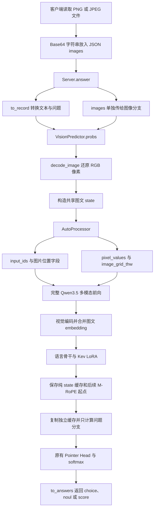

# Kev 图像输入改造说明

本文说明当前工作区如何将 Kev 从文本决策模型扩展为图文决策模型，重点解释图片占位 token 的数量如何确定，以及 `AutoProcessor` 在整个流程中的职责。

说明依据为当前 `kev/` 源码、已安装的 Transformers 5.17.0，以及本地 Qwen3.5-0.8B-Base 的实际 processor 输出。更新日期为 2026-10-27，图像路径已使用单次请求内的图文前缀缓存。这是当前工作区的实现说明，不代表上游 Kev 已经发布这些功能。

## 1. 改造目标和权重组成

原有 Kev 加载 Qwen 的文本骨干，应用 Kev LoRA，然后由 Pointer Head 对候选选项打分。本次改造保留 Qwen3.5 的完整视觉路径，把已加载 Kev LoRA 的语言骨干装入多模态模型。

核心装配发生在 `Checkpoint.load_vision()`：

```python
# model 由现有 Checkpoint.load() 得到，已经加载 LoRA 和 Pointer Head。
processor = AutoProcessor.from_pretrained(meta.base, revision=meta.base_revision)
backbone, loading = Qwen3_5Model.from_pretrained(
    meta.base,
    revision=meta.base_revision,
    dtype=dtype,
    attn_implementation=attn,
    device_map="cpu",
    output_loading_info=True,
)
backbone.language_model = model.lm
backbone = backbone.to(model.device).eval()
```

上面摘录了关键语句。完整方法还检查模型类型、权重缺失和不兼容配置。

| 组件 | 来源 | 本次是否训练 |
|---|---|---|
| 视觉编码器、视觉特征合并与投影 | 对应 revision 的 Qwen3.5 底座 | 否 |
| 语言骨干 | 原有 Kev 加载流程 | 否 |
| Kev LoRA | Kev 检查点，默认可合并到语言骨干 | 否 |
| Pointer Head | Kev 检查点 | 否 |
| 温度 | 检查点保存的文本任务温度 | 未针对图像重新拟合 |

视觉编码算法没有在 `vision.py` 中重写。新增代码负责接线、组织输入、定位读出位置和返回结果。

## 2. 完整执行流程



问题、选项和决策标记由 tokenizer 单独编码。Head 读取的是问题分支输出的隐藏状态，索引相对于分支起点。

### 2.1 Base64 只解决 JSON 传输

客户端读取的是 PNG/JPEG 文件字节，而不是先把 RGB 像素编码一次：

```text
PNG/JPEG 文件字节 → Base64 字符串 → HTTP JSON
HTTP JSON → Base64 解码 → 原文件字节 → Pillow 解码 → RGB 像素
```

Base64 不产生视觉特征。Pillow 的 `convert("RGB")` 也不产生模型 embedding，它只统一像素格式。真正的视觉特征由后面的 Qwen3.5 视觉网络计算。

### 2.2 图片放在 state 末尾

当前新增的请求字段为：

```python
images: list[str] = Field(default_factory=list, max_length=8)
```

`to_record()` 继续把文本 state、问题和选项转换成 Kev 内部记录，图片绕过文本展平过程。

完整图文序列的语义布局如下。运行时 `encode_prefix()` 将图文 state 和纯文本问题分开编码，先算 state，再续算各问题；`encode_batch()` 保留完整序列路径用于数值对照：

```text
<state>状态文本
<|vision_start|><|image_pad|><|vision_end|>
<q>问题文本
<opt>选项一</opt>
<opt>选项二</opt>
<decide>
```

`<state>`、`<q>` 等是便于阅读的简称。代码实际使用 Kev 原有的 `SPECIAL`：

| 含义 | 实际 token |
|---|---|
| state 开始 | `<|fim_prefix|>` |
| 问题开始 | `<|fim_middle|>` |
| 选项开始 | `<|box_start|>` |
| 选项结束 | `<|box_end|>` |
| 决策位置 | `<|fim_suffix|>` |

输入不套用默认聊天模板，以保留 Kev 的训练序列格式。用户文本先经过 `user_text()` 转义，程序再插入控制标记。

## 3. AutoProcessor 具体做什么

`AutoProcessor` 是按模型配置选择具体处理器的入口。它本身不是视觉神经网络，也不负责理解图中有哪些物体。

当前本地底座实际加载的类为：

```text
AutoProcessor
└── Qwen3VLProcessor
    ├── tokenizer
    ├── image_processor: Qwen2VLImageProcessor
    └── video_processor
```

类名中出现 Qwen3VL、Qwen2VL 是 Transformers 复用处理组件的结果。模型依然是 Qwen3.5；必须使用底座配置实际选出的类和参数，不能凭类名替换。

本次使用的入口是：

```python
inputs = self.processor(
    text=prompts,
    images=images * len(prompts),
    add_special_tokens=False,
    padding=True,
    padding_side="right",
    return_mm_token_type_ids=True,
    return_tensors="pt",
)
```

处理过程按下面的顺序执行。

### 3.1 预处理图片，得到网格大小

图片处理器调整分辨率，使高度和宽度满足 patch 与合并规则，并满足配置的像素预算。随后进行像素缩放、归一化、patch 切分和重排，生成：

- `pixel_values`：供视觉网络使用的 patch 像素张量，尚不是语义 embedding。
- `image_grid_thw`：每张图片的时间、高度、宽度网格大小。

当前本地配置为：

```text
patch_size = 16
temporal_patch_size = 2
merge_size = 2
image_mean = [0.5, 0.5, 0.5]
image_std = [0.5, 0.5, 0.5]
```

当前缩放实现将尺寸对齐到 `patch_size × merge_size = 32` 的整数倍。原图过大或过小也可能被缩放，因此不能始终直接用原图分辨率计算 token 数量。

配置 `size` 中当前名为 `shortest_edge`、`longest_edge` 的数值，在该处理器的缩放流程中用于最小、最大像素面积预算，不能简单当作图片边长。

### 3.2 根据网格，把一个图片标记展开成多个占位 token

Kev 只为每张图片插入一组：

```text
<|vision_start|><|image_pad|><|vision_end|>
```

processor 根据图片网格，将其中单个 `<|image_pad|>` 替换为该图片所需数量的连续 `<|image_pad|>`。这一步发生在文本 tokenizer 编码之前。

因此要区分：

- 初始图片块数量：由 Kev 根据 `len(images)` 决定。
- 每个图片块内部的占位 token 数量：由 processor 根据实际预处理网格决定。

### 3.3 编码文本并返回统一输入

占位符展开后，tokenizer 将最终序列转换为 token ID。`<|image_pad|>` 是一个已注册的特殊 token，其重复次数会对应到同样数量的 ID。

processor 同时生成 attention mask 和多模态 token 类型信息，最终返回以下字段：

| 字段 | 作用 |
|---|---|
| `input_ids` | 文字、边界标记和展开后的图片占位 token ID |
| `attention_mask` | 标识实际输入位置与 padding |
| `pixel_values` | 图片 patch 像素数据 |
| `image_grid_thw` | 视觉网格，供视觉网络和位置编码使用 |
| `mm_token_type_ids` | 标识文本、图片、视频 token；当前图片输入中 0 为文本、1 为图片 |

这些字段通过 `self.backbone(**inputs, ...)` 一起传入模型。

processor 提供位置计算需要的元数据。`VisionPredictor.prefix()` 调用 Qwen3.5 原有 `get_rope_index()` 计算图文 state 的位置，显式传给多模态前向。后续纯文本分支从这些位置的最大值加一继续，而不是直接使用缓存 token 数作为 M-RoPE 编号。

## 4. 为什么能提前算出图片需要多少占位 token

关键在于，当前视觉网络的输出长度由预处理后的网格和固定合并规则决定。网络需要推理才能得到每个向量的数值，但无需推理就能确定会输出多少个向量。

### 4.1 计算公式

设预处理后的尺寸为 `H' × W'`，空间 patch 大小为 `p`，空间合并倍数为 `m`：

```text
grid_h = H' / p
grid_w = W' / p
grid_t = 时间 patch 组数

视觉编码器输入 patch 数 = grid_t × grid_h × grid_w
供语言骨干使用的视觉 token 数 N = grid_t × grid_h × grid_w / m²
图片内部占位 token 数 = N
```

对于当前静态图片，`grid_t = 1`。这里的 `m = 2` 表示每个 2×2 的空间 patch 组对应一个合并后的视觉 token，所以除以 4。

processor 的 `Qwen3VLProcessor.replace_image_token()` 实际按下面的规则计算，变量名与表达式来自当前安装源码：

```python
merge_length = self.image_processor.merge_size**2
num_image_tokens = image_inputs["image_grid_thw"][image_idx].prod() // merge_length
```

### 4.2 数量已知，不代表内容已知

同样的预处理网格，不论图片中是人、车辆还是风景，当前这条无内容自适应 token 剪枝的路径都会得到相同的视觉 token 数量。

可以预先知道矩阵是 `[N, D]`，但矩阵中的数值必须通过视觉网络计算。物体数量、图片文件大小、PNG/JPEG 压缩率都不直接决定 N。

“提前计算”准确地说，是在视觉神经网络前向之前，根据预处理已确定的尺寸计算。当前 processor 已经完成了图片预处理，并非完全不读取图片。

如果模型改用内容自适应裁剪、token 剪枝或其他动态策略，需要按新实现重新核对，不能把这个公式推广到所有视觉模型。

### 4.3 静态图片为什么还有 temporal_patch_size

当前底座的 `temporal_patch_size = 2`，但静态图片的 `grid_t` 仍然为 1。图片处理器在单张图片的 patch 数据中扩展时间维，以适配视觉 patch embedding 的输入结构。

因此 `temporal_patch_size` 会影响每个原始 patch 向量的宽度；不能再把静态图像 token 数额外乘以 2。

## 5. 用当前街景图核对完整计算

已使用 `/home/AI/kev/output/imagegen/street-decision-20261026.png` 做实际 processor 检查，没有加载视觉模型权重执行前向。

| 检查项 | 实际值 |
|---|---|
| 原图宽、高 | 1536、1024 |
| `image_grid_thw` | `[1, 64, 96]` |
| `pixel_values.shape` | `[6144, 1536]` |
| 计算得到的图片占位数量 | 1536 |
| 最终 `input_ids` 中图片占位 ID 的实际数量 | 1536 |
| 只含图片块时的 `input_ids.shape` | `[1, 1538]` |
| 图片 token ID | 248056 |

计算展开为：

```text
H' = 1024，W' = 1536
grid_h = 1024 / 16 = 64
grid_w = 1536 / 16 = 96

原始 patch 数 = 1 × 64 × 96 = 6144
合并后的视觉 token 数 = 6144 / (2 × 2) = 1536
图片块总 token 数 = 1 个 vision_start + 1536 个 image_pad + 1 个 vision_end
                 = 1538
```

`pixel_values` 的两个维度含义分别是：

```text
6144 = 原始 patch 数量
1536 = 3 个颜色通道 × 2 个时间采样位置 × 16 × 16 像素
```

这里恰好又出现了数值 1536，但它和“占位 token 数为 1536”含义完全不同。不能把 `pixel_values.shape[1]` 当作 token 数。

Qwen3.5-0.8B 的语言隐藏维度是 1024。因此经过视觉网络及合并投影后，当前这张图片将对应 `[1536, 1024]` 的视觉特征。这是由结构推导出的形状，本文没有把它冒充为本次 processor 检查实际测得的视觉网络输出。

## 6. 模型怎样把占位符变成图片信息

processor 输出的 `input_ids` 中，所有图片占位位置的 ID 都相同。图片内容由单独的 `pixel_values` 携带。

Qwen3.5 的完整模型前向执行：

1. 将 `input_ids` 转成序列 embedding。
2. 将 `pixel_values`、`image_grid_thw` 送入 `self.visual(...)`，经过视觉网络和 patch merger 得到视觉特征。
3. 检查图片占位位置数量与视觉特征数量是否一致。
4. 在图片占位位置，用计算得到的视觉向量替换原来的 token embedding。
5. 计算图文位置编号，将合并后的 embedding 送入带 Kev LoRA 的语言骨干。

核心替换发生在模型内部：

```python
inputs_embeds = inputs_embeds.masked_scatter(image_mask, image_embeds)
```

这里替换的是 embedding，`input_ids` 本身依然保留图片特殊 token 的 ID。图像特征按同样的图片顺序和 patch 顺序对齐；数量相同只是必要条件，顺序也必须匹配。

processor 使用 `merge_size²` 计算占位数量；视觉模型用 `spatial_merge_size²` 产生对应数量的特征。两侧参数来自同一底座配置，因此能够在神经网络前向前后保持长度一致。

## 7. Kev 如何继续读出决策

### 7.1 展开图片后重建索引

完整图文路径中，图片展开会使后续问题和选项的位置后移。前缀缓存路径将问题单独编码，所以读出索引直接相对于分支，不再包含图文 state 的长度。

`VisionPredictor._readouts()` 扫描问题开始、选项结束、决策标记，并检查每题恰有一个问题标记、一个决策标记和 K 个选项结束标记。完整序列对照路径与纯分支路径共享这个检查，较短的行都在右侧 padding。

### 7.2 复用原有 Head

模型前向结束后：

```python
hidden = outputs.last_hidden_state.float()
logits = self.head(
    hidden[row, decide_idx],
    hidden[row, option_idx.to(hidden.device)],
)
probabilities = logits.softmax(dim=-1).cpu()
```

Pointer Head 读取已经通过语言骨干融合了视觉信息的隐藏状态。它同时使用决策位置和各候选选项结束位置的表示，保持原有的投影、点积打分及 softmax 机制。

这条路径不先生成图片描述，也不把视觉网络替换成 OCR。是否能正确识别某种图像内容，仍取决于底座、Kev 文本微调后的迁移效果和题目本身。

## 8. 修改文件和职责

| 文件 | 改造职责 |
|---|---|
| `kev/api.py` | 为请求增加最多 8 张图片的 Base64 字符串列表 |
| `kev/model.py` | 提取 `user_text()`，共享用户文本转义；Pointer Head 结构不变 |
| `kev/checkpoint.py` | 新增 `load_vision()`，加载同版本视觉底座并接入现有语言骨干 |
| `kev/vision.py` | 图片只预处理一次、建立图文前缀、复制 hybrid 缓存、按块计算纯文本分支并用 Head 读出 |
| `kev/serve.py` | 增加 `--vision`、图文分流、错误处理与模型状态 |
| `pyproject.toml`、`uv.lock` | 加入图片处理与 SOCKS 代理所需依赖 |
| `tests/test_serve_vision.py` | 验证服务层分流、错误、缓存绕过及加载参数，不验证真实视觉准确率 |
| `tests/test_vision_batch.py` | 验证完整前向与前缀续算一致、独立状态复制、多图和问题分块 |

当前 `/v1/systemone` 无图请求沿用文本路径；有图请求进入图像路径。图片预处理、视觉编码和语言骨干对图文 state 的前向各执行一次。缓存只在本次请求中复用，不加入服务的跨请求文本 LRU。

图像分支的 `usage.input_tokens` 保留原来各题完整输入长度之和的语义，不计 padding。它表示逻辑输入量，不等于缓存后实际新处理的 token 数。实际新增 token 数为 `state_len + 各分支长度之和`，而逻辑输入量为 `题数 × state_len + 各分支长度之和`。

### 8.1 图文前缀如何建立和续算

`encode_prefix()` 只把共享 state 和每张图片送给 processor 一次，所有问题由 tokenizer 单独编码。上下文预算在模型前向之前检查。

`prefix()` 返回 `VisionPrefix`，只保存三项：

| 字段 | 含义 |
|---|---|
| `cache` | attention KV，以及 hybrid 层的卷积和循环状态 |
| `length` | 已缓存的真实序列长度，供 attention mask 使用 |
| `next_position` | Qwen 原生 state 位置的最大值加一，供后续文本 M-RoPE 使用 |

没有保存整段 state 隐藏状态，因为当前 Head 的两个读出位置都在问题分支中。state 的视觉信息已经进入缓存。

`probs_with_prefix()` 按块复制原始缓存，再通过 `reorder_cache()` 从第 0 行扩展出当前块需要的独立状态行。分支只输入问题与选项，attention mask 包含缓存前缀和新增分支。三组 M-RoPE 坐标从 `next_position` 延续；位置显式传入语言骨干，不依赖多模态模型的全局 `rope_deltas` 属性。

每个块的行数为 `max(1, max_branch // 最长完整行长度)`，以完整行 token 预算约束缓存复制规模；较短问题块还会去除其他块留下的多余 padding。这个策略限制批量规模，但不是精确的显存上限。

原始前缀在处理任何问题前就已建立，且每个问题块只修改其独立副本，因此问题之间没有信息传递。每个问题仍会读取 state 的 attention KV、继承其循环状态，省掉的是 state token 的重复逐层计算。

### 8.2 本次验证

无下载权重的小型 Qwen3.5 测试覆盖多图、不同长度问题、缓存与完整前向一致性、问题隔离、缓存反复复用、按不同块大小执行，以及插入另一条图像请求后的状态隔离。

本地 `/home/AI/models/kev-0.8b` 的 CUDA fp32 实际权重对照使用缩小后的街景图和三道题：一张图时最大概率差 `5.66e-7`，两张图时最大概率差 `1.07e-6`，均无 argmax 改变。这是数值一致性验证，不是视觉准确率或性能提升评测，也没有覆盖 bf16、MPS 和其他检查点。

原有缓存主要以 state token ID 建键。不同图片可能具有完全相同的占位 ID 序列，直接套用会将不同视觉内容误认为同一状态。将来引入图像缓存时，还需要明确图像内容身份、预处理参数及多模态位置状态。

## 9. 启动和复现占位数量

当前本地目录中的底座快照与 Kev 检查点记录的 revision 匹配。使用以下方式从本地缓存加载：

```bash
HF_HUB_OFFLINE=1 uv run --extra serve python -m kev.serve \
  --run /home/AI/models/kev-0.8b \
  --port 8009 \
  --vision
```

下面的检查只运行 processor，不运行模型前向，可独立验证占位数量：

```bash
HF_HUB_OFFLINE=1 uv run --extra serve python - <<'PY'
from PIL import Image
from transformers import AutoProcessor

processor = AutoProcessor.from_pretrained(
    "/home/AI/models/Qwen3.5-0.8B-Base",
    local_files_only=True,
)
with Image.open("/home/AI/kev/output/imagegen/street-decision-20261026.png") as image:
    image = image.convert("RGB")

inputs = processor(
    text=["<|vision_start|><|image_pad|><|vision_end|>"],
    images=[image],
    add_special_tokens=False,
    return_mm_token_type_ids=True,
    return_tensors="pt",
)
grid = inputs["image_grid_thw"][0]
expected = int(grid.prod()) // processor.image_processor.merge_size**2
actual = int((inputs["input_ids"] == processor.image_token_id).sum())
print("image_grid_thw:", grid.tolist())
print("pixel_values:", tuple(inputs["pixel_values"].shape))
print("expected / actual image tokens:", expected, actual)
print("input_ids:", tuple(inputs["input_ids"].shape))
assert expected == actual
PY
```

## 10. 能力边界与后续验证

本次接通了静态图片输入和图文决策前向，没有重新训练。当前实现只支持 dense Qwen3.5 底座；图像在 state 末尾按列表顺序追加，未实现图片穿插文本、图片候选项或视频请求。

图片展开后参与上下文预算检查；当前图像 state 和 state 加单题的完整序列分别受服务配置限制，超限返回 422，不裁断视觉 token 序列。图片分辨率增加通常会增加 patch 数、语言输入长度和处理耗时。

同一张图片可以在文本训练的决策头上得到合理答案，但不能据此证明所有视觉能力可靠。已有街景测试中，计数与空间关系题出现错误。图像任务的准确率与概率校准应单独评测，现有文本温度不能视为图像校准已经完成。

## 11. 源码核对入口

项目中的调用链：

- [请求模型与文本转换](../kev/api.py)：`SystemOneRequest`、`to_record()`。
- [加载多模态组件](../kev/checkpoint.py)：`Checkpoint.load_vision()`。
- [图像路径](../kev/vision.py)：`decode_image()`、`VisionPredictor.encode_prefix()`、`prefix()`、`probs_with_prefix()`；`encode_batch()` 是完整前向对照入口。
- [服务分流](../kev/serve.py)：`Server.answer()`、`Server.probs()`、`main()`。
- [原有 Head 与转义](../kev/model.py)：`PointerHead`、`user_text()`。

Transformers 5.17.0 中的对应实现：

- [图片预处理](https://github.com/huggingface/transformers/blob/v5.17.0/src/transformers/models/qwen2_vl/image_processing_qwen2_vl.py)：`smart_resize()`、`patchify()`、`_preprocess()`。
- [图片占位展开](https://github.com/huggingface/transformers/blob/v5.17.0/src/transformers/models/qwen3_vl/processing_qwen3_vl.py)：`Qwen3VLProcessor.replace_image_token()`。
- [processor 调度](https://github.com/huggingface/transformers/blob/v5.17.0/src/transformers/processing_utils.py)：`ProcessorMixin.__call__()`、`_process_images()`。
- [视觉编码、合并与多模态前向](https://github.com/huggingface/transformers/blob/v5.17.0/src/transformers/models/qwen3_5/modeling_qwen3_5.py)：`Qwen3_5VisionModel`、`Qwen3_5VisionPatchMerger`、`Qwen3_5Model.get_image_features()`、`get_placeholder_mask()`、`forward()`。
