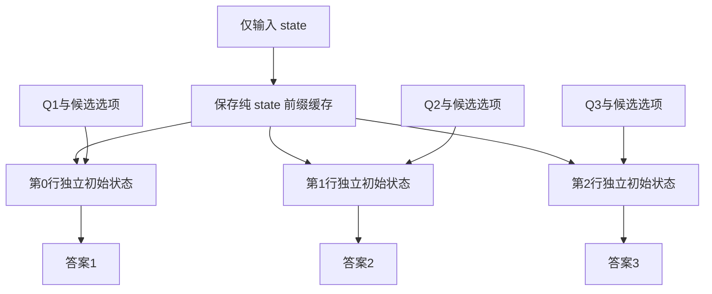

# Kev 如何共享 state 并保持各问题独立

本文依据当前工作区源码整理，说明三条文本执行路径及新增图像路径。图像部分于 2026-10-27 更新为请求内图文前缀缓存。

核心结论：共享 state 内容、复用 state 计算结果、隔离各问题，是三个不同的目标。Kev 对不同模型选择不同的执行方式，不能把所有路径都描述成“先算一次 state，再计算问题”。

## 1. 基本概念

假设请求包含一份状态和三道题：

```text
state：客户被重复扣款，要求退款。
Q1：交给哪个部门？候选项为账务、物流、技术支持。
Q2：是否要求退款？候选项为否、是。
Q3：紧急程度？候选项为低、中、高。
```

每道题都需要访问相同的 state，但不需要访问其他题目的问题、选项或输出。

| 概念 | 含义 | 是否需要缓存 |
|---|---|---|
| 共享 state 内容 | 各题使用同一份输入信息 | 否，可以重复输入并计算 |
| 复用 state 计算结果 | state 前向结果供多个问题或后续请求使用 | 跨前向复用需要缓存 |
| 问题隔离 | Q1 的内容及计算状态不能流入 Q2 | 依靠 mask、独立 sequence 或独立前向实现 |

“答案独立”在本文指计算依赖隔离，不是统计独立。各题共享模型参数和事实来源，答案仍然可能相关，也可能出现相似错误。

输入包含问题与候选选项，不包含已知的正确答案。训练标签用于计算损失，不作为待评分分支中的答案文本输入。

## 2. 当前路径总览

| 执行路径 | 输入组织 | state 如何处理 | 问题如何隔离 |
|---|---|---|---|
| attention-only，无前缀缓存 | 单条 packed sequence 包含 state 和多题分支 | state 在该序列中出现并计算一次 | block-causal attention mask |
| hybrid，无前缀缓存 | 每题一条 sequence，合成 batch | 各行重复计算 state | batch 中不同 sequence 的状态独立 |
| hybrid，前缀缓存路径 | 先算 state；问题分支组成 batch | 显式传入 state 缓存的独立副本 | 各行从相同初始状态分别继续 |
| 当前图像路径 | 每题单独调用完整图文模型 | 每题重算图文 state | 独立输入、独立完整前向 |

attention-only 也支持前缀缓存，主要用于跨请求复用相同 state；详见第 8 节。

## 3. 编码阶段先定义共享区与问题分支

代码入口为 `kev/model.py` 的 `encode()`。

内部布局为：

```text
[state]
[Q1指令 + Q1候选选项 + decide]
[Q2指令 + Q2候选选项 + decide]
[Q3指令 + Q3候选选项 + decide]
```

其中 `state`、`decide` 是说明用简称，实际使用项目已有的特殊 token。

编码结果包括：

| 字段 | 作用 |
|---|---|
| `ids` | token ID 序列 |
| `seg` | state 标为 0，问题分支分别标为 1、2、3 |
| `pos` | 每个 token 的位置编号 |
| `decide_idx` | 每道题的决策位置 |
| `opt_idx` | 每道题各候选选项的结束位置 |

设 state 长度为 `Ls`。各问题分支的位置编号都从 `Ls` 开始：

```text
state：位置 0 ... Ls-1
Q1：   位置 Ls ...
Q2：   位置 Ls ...
Q3：   位置 Ls ...
```

Q2 虽然在 packed 存储中排在 Q1 后面，但其位置编号不累计 Q1 的长度。这避免插入、删除或移动其他问题时，仅因位置变化就改变本题的表示。

## 4. attention-only 用 mask 阻断跨问题读取

### 4.1 可见范围

`branch_mask_batch()` 规定：位置 `i` 可以读取位置 `j`，当且仅当 `j <= i`，并且 `j` 属于 state 或与 `i` 属于同一分支。

```text
allow(i, j) = causal(i, j)
              AND (seg[j] == 0 OR seg[j] == seg[i])
```

以下表格按分支展示规则，分支内部还要遵守 causal 顺序：

| query 所在区域 | state | Q1 | Q2 | Q3 |
|---|---|---|---|---|
| state | 只读此前及当前位置 | 不可读 | 不可读 | 不可读 |
| Q1 | 可读 | 只读此前及当前位置 | 不可读 | 不可读 |
| Q2 | 可读 | 不可读 | 只读此前及当前位置 | 不可读 |
| Q3 | 可读 | 不可读 | 不可读 | 只读此前及当前位置 |

实现使用加性 mask，允许位置为 0，禁止位置为当前 dtype 的最小有限数。

### 4.2 为什么没有间接泄漏

隔离规则在每个 attention 层中应用，state 自身也看不到任何问题。

因此既不存在 `Q1 → Q2` 的直接通道，也不存在 `Q1 → state → Q2` 的间接通道。对该 attention-only 骨干，每一层中 Q2 的表示都只能依赖 state 和 Q2 自身。

普通下三角 causal mask 不够。若只是把问题顺序拼接，后面的 Q2 可以读取前面的 Q1；Kev 增加了分支条件才阻断这种依赖。

### 4.3 共享 state 不一定需要前缀缓存

在这条 packed 路径中，state 只在输入中放一份，所以同一次完整前向里就可以被多题读取，无需先单独计算 state。

注意力仍然需要分别计算各个问题对 state 的读取；“state 计算一次”不等于所有问题的后续计算也被消除了。

## 5. hybrid 为什么改成每题一条 sequence

Qwen3.5 的 hybrid 结构同时包含 full-attention 与 Gated DeltaNet 层。DeltaNet 通过沿序列演进的循环状态传递信息，现有 packed attention mask 无法直接为它创建独立的问题分支。

若将全部问题放在同一条 causal sequence 中：

```text
state → Q1 → Q2 → Q3
```

即使 attention 层屏蔽了跨题读取，循环层仍可能把 Q1 更新过的状态交给 Q2。因此 Kev 为 hybrid 模型选择不同输入组织方式。

### 5.1 检测 hybrid

`DecisionModel.__init__()` 检查模型配置：

```python
self.hybrid = "linear_attention" in set(getattr(cfg, "layer_types", None) or [])
```

`forward_batch()` 再根据该标记分流：

```python
if self.hybrid:
    return self.forward_rows_batch(encs)
```

### 5.2 从逻辑记录拆成独立行

`rows_of(enc)` 将原有编码拆成共享 state 和各问题分支。`forward_rows_batch()` 给每个分支拼上相同 state：

```python
S, Sp, brs = rows_of(e)
for r in brs:
    rows.append((S + r["ids"], Sp + r["pos"]))
```

形成：

```text
batch 第0行：[state + Q1 + Q1选项 + decide]
batch 第1行：[state + Q2 + Q2选项 + decide]
batch 第2行：[state + Q3 + Q3选项 + decide]
```

`_pad_rows()` 在右侧补齐不同长度的行，并生成 padding mask：

```text
input_ids.shape = [B, L_max]
hidden_states.shape = [B, L_max, D]
```

B 是本次所有记录的题目总数，可以大于原始请求记录数量。每一行是一条完整 sequence；换行符本身不产生隔离，batch 张量的第一维才表示独立序列。

### 5.3 为什么放进同一个 batch 仍然独立

Attention 通常对 `[B, heads, L, d]` 的 Q、K、V 执行批量矩阵乘法。第 b 行计算：

```text
A[b] = softmax(Q[b] × K[b]ᵀ / sqrt(d) + mask[b])
O[b] = A[b] × V[b]
```

不会计算 `Q[0] × K[1]ᵀ`。注意力分数的两个 token 维度均属于同一行。

当前安装的 Qwen3.5 实现中，DeltaNet 循环状态也包含 batch 维度：

```text
[B, num_v_heads, k_head_dim, v_head_dim]
```

更新可以概括为：

```text
state[b, t] = F(state[b, t-1], input[b, t], weights)
```

这里的 `state[b, t]` 表示内部循环状态，不是 API 的文本 state。每一行沿自己的时间轴更新，没有从 b 行传给 b+1 行的步骤。卷积状态也分别对应每条序列。

共享模型权重不等于共享运行状态。训练时各行梯度会共同更新参数，但这不使同一次前向中的 Q2 看见 Q1。

### 5.4 这条无缓存路径的代价

每行都有完整 state，因此 state 会被重复计算。一次 batch 调用只表示可以批量执行，不表示相同前缀自动去重。

逐题拆分属于 Kev 的输入组织逻辑；不同 batch 行的独立计算是 Qwen3.5 原生支持的能力。这条路径没有重写底座的 attention 或 DeltaNet 算法。

## 6. hybrid 前缀缓存如何同时复用与隔离



### 6.1 先单独计算纯 state

`prefix(enc)` 只输入前 `Ls` 个 state token：

```python
out = self.lm(
    input_ids=ids,
    position_ids=pos,
    past_key_values=DynamicCache(config=self.lm.config),
    use_cache=True,
)
return Ls, out.past_key_values, out.last_hidden_state[0].float()
```

对 hybrid 模型，返回的 `past_key_values` 不只是 attention KV，还包含相应层的循环和卷积状态。名称虽然叫 KV cache，实际缓存内容取决于模型架构。

这份原始缓存没有包含任何问题信息，所以可以作为各题一致的初始状态。

### 6.2 复制并扩展缓存的 batch 维度

`_branch_rows_from_prefix()` 执行：

```python
S, Sp, rows = rows_of(enc)
Q = len(rows)
cache = copy.deepcopy(cache)
cache.reorder_cache(torch.zeros(Q, dtype=torch.long, device=self.device))
```

`deepcopy()` 避免修改服务中保存的原始前缀。长度为 Q 的全零索引从原始缓存第 0 行取出 Q 份相同初始状态，构成问题 batch 的缓存。

扩展后的第 i 行只更新自己的状态切片。各题初始值相同，不表示它们随后共用同一个可变状态。

### 6.3 新输入只包含问题分支

此时不会把完整 state token 再放进每行的 `input_ids`：

```python
ids, pos, att = self._pad_rows([
    (r["ids"], r["pos"]) for r in rows
])
att = torch.cat([
    torch.ones((Q, len(S)), dtype=torch.long, device=self.device),
    att,
], 1)
h = self.lm(
    input_ids=ids,
    position_ids=pos,
    attention_mask=att,
    past_key_values=cache,
    use_cache=True,
).last_hidden_state.float()
```

`input_ids` 只有新增分支；`position_ids` 延续 state 后的位置；attention mask 的长度覆盖已缓存 state 和本次新增分支。

state 对应的信息通过 `past_key_values` 提供。每个问题仍会执行对 state 的 attention 读取或使用继承的循环状态，但无需重新跑一遍 state token 的各层计算。

### 6.4 use_cache 不等于自动缓存命中

`use_cache=True` 允许模型产生或更新缓存。真正复用已有 state 的动作是显式传入 `past_key_values=cache`。

当前 Kev 的 Hugging Face 调用不会自动扫描 batch，发现各行 token 前缀相同就去重。提交完整 `state + Q1`、`state + Q2` 并只设置 `use_cache=True`，不会自动得到本文的复用效果。

部分推理引擎提供自动前缀匹配，属于另一种接口与调度机制。

### 6.5 为什么 hybrid 缓存 miss 需要两次模型调用

`probs_and_prefix()` 对 hybrid 先调用 `prefix()`，再调用 `_branch_rows_from_prefix()`。因此是一次 state 前向，加一次问题分支 batch 前向。

不能先运行 `state + Q1`，然后仅凭裁切 token 长度恢复 state 时刻的 DeltaNet 状态。循环状态经过 Q1 后已经发生更新，不能像普通 attention KV 张量那样直接切回过去。因此代码专门在问题开始前保存纯 state 状态。

## 7. 服务何时选择缓存路径

入口为 `kev/serve.py` 的 `Server.probs()`。文本请求先编码，再计算：

```python
Ls = enc["seg"].count(0)
key = (tuple(enc["ids"][:Ls]), bool(enc.get("option_isolation")))
eligible = PREFIX_CACHE_SIZE and Ls >= PREFIX_MIN_TOKENS
```

分流如下：

| 条件 | 调用 | hybrid 中的行为 |
|---|---|---|
| 未满足缓存条件 | `model.probs(enc)` | 每题完整 state + 分支，组成 batch |
| 满足条件，缓存 miss | `model.probs_and_prefix(enc)` | 先计算 state，再计算问题 batch，保存纯 state 缓存 |
| 满足条件，缓存 hit | `model.probs_with_prefix(enc, prefix)` | 复用 state 缓存，直接计算问题 batch |

默认配置：

```text
KEV_PREFIX_CACHE=4
KEV_PREFIX_MIN_TOKENS=384
```

容量 4 指最多保留 4 个 state 前缀条目。`Ls` 包含 state 开始标记。容量为 0 时关闭该缓存路径；短 state 默认不缓存。

配置在服务进程导入模块时读取，修改环境变量后需要重启相应进程。

### 7.1 请求内复用和跨请求复用

缓存 miss 时，长 state 在当前请求内计算一次，供多题分别继续。缓存保留后，下一个具有相同 key 的请求也可以复用，即使问题集合改变。

这里匹配的是服务实际编码后的整个 state token 前缀，包含预处理、转义及可能截断后的结果。它不提供任意公共子串或部分相同前缀的匹配。

服务实例绑定已加载模型，并在锁内更新缓存及推理，避免请求同时修改其状态。

调用底层 `probs_with_prefix()` 时，调用者需要提供与 state 相匹配的缓存。该方法只检查 state 长度，不能依靠它独立判断相同长度的两份 state 是否内容一致；服务层通过缓存 key 承担内容匹配责任。

## 8. attention-only 的缓存路径有何不同

attention-only 的 `probs_and_prefix()` 可以执行一次 packed 全量前向，然后将 attention KV 裁回 state 长度，保存纯 state 前缀。

这样处理成立，是因为 state 通过 mask 保持独立，其 KV 没有包含问题信息，且普通 attention cache 可以按 token 位置裁切。

缓存 hit 时，`probs_with_prefix()` 只输入问题 token，保留分支 mask，并显式传入 state KV。它在 `finally` 中把缓存裁回 state 长度，使缓存可以继续复用。

这和 hybrid 的“先单独保存 state，再复制各题状态”是不同实现，不能相互替代。

## 9. Head 为什么不让各题的概率互相竞争

每道题拥有自己的决策位置与候选选项位置。Head 单独计算该题的 K 个 logits：

```python
self.head(h_decide, h_options)
```

随后按题分别 softmax。Q1 和 Q2 的选项不进入同一个 softmax 分母。

因此题目隔离同时涉及：输入与状态不跨题传递、读出索引按题对应、概率按题归一化。仅拆开 softmax，无法弥补前面骨干已经发生的跨题信息泄漏。

同一道题内的候选项默认可以影响后续候选项的表示。问题隔离不等于候选选项隔离；额外的 `option_isolation` 是另一种机制，当前 hybrid 路径不支持它。

## 10. 当前图像路径的实际状态

`VisionPredictor.probs()` 先建立图文前缀，再按块计算问题分支：

```python
state, branches, readouts = self.encode_prefix(rec, images)
prefix = self.prefix(state)
probabilities = self.probs_with_prefix(
    branches, readouts, prefix, rows_per_pass
)
```

`encode_prefix()` 只预处理一份图文 state，问题和选项由 tokenizer 单独编码。`prefix()` 使用原生 `get_rope_index()` 得到图文位置，执行一次完整多模态 state 前向，保存 attention KV、卷积和循环状态。

续算时每个问题块使用原始缓存的深复制，再扩展 batch 维度，每行只输入自己的问题和选项。图片不会再次传入视觉网络，state 也不会再次执行语言骨干前向。缓存副本之间可以有相同初始值，但独立更新。

图像 token 的实际序列长度与 M-RoPE 坐标长度不同。`VisionPrefix.length` 用于 attention mask；`next_position` 是前缀位置最大值加一，用于问题的三组 M-RoPE 位置。分支索引相对于分支起点，不再加上 state 长度。

这份缓存只在当前请求内复用，不存入 `Server.prefix_cache`。因此服务的 `prefix_cache_hit` 仍表示跨请求缓存命中，图像请求保持 False，`KEV_PREFIX_CACHE` 不控制图像请求内的共享。未来若增加跨请求图文缓存，必须把图片内容和预处理配置纳入身份判断，不能只比较占位 token ID。

## 11. 代码入口与验证方法

| 关注点 | 源码入口 |
|---|---|
| 分支编码、位置编号 | [model.py](../kev/model.py) 的 `encode()` |
| attention 隔离 | `branch_mask_batch()`、`hidden_batch()` |
| 拆分 state 与问题 | `rows_of()` |
| 无缓存 hybrid batch | `forward_rows_batch()`、`_pad_rows()` |
| hybrid 缓存副本与分支计算 | `_branch_rows_from_prefix()` |
| state 前向和缓存保存 | `prefix()`、`probs_and_prefix()` |
| 使用已有缓存 | `probs_with_prefix()` |
| 服务条件和 LRU | [serve.py](../kev/serve.py) 的 `Server.probs()` |
| 图文前缀及分支缓存路径 | [vision.py](../kev/vision.py) 的 `VisionPredictor.prefix()`、`probs_with_prefix()`、`probs()` |
| 隔离与缓存数值测试 | [test_model.py](../tests/test_model.py) |

当前安装的 Transformers 5.17.0 中，hybrid 内部状态可查看：

```text
.venv/lib/python3.12/site-packages/transformers/models/qwen3_5/modeling_qwen3_5.py
  torch_chunk_gated_delta_rule()
  torch_recurrent_gated_delta_rule()
  Qwen3_5GatedDeltaNet.forward()
```

建议用以下对照检查实现：

1. 同一道题单独运行与放在多题请求中运行，概率应在合理数值误差内一致。
2. 改写其他题目的问题和选项，本题结果应保持一致。
3. 缓存路径与完整 state + 问题前向的概率应一致。
4. 连续复用同一份前缀，再次运行同题，结果应一致，验证原始前缀没有被污染。
5. 改变问题顺序，再按问题 ID 对齐结果，应保持一致。

“一致”指推理模式下的数值等价性。不同 batch 形状、精度和内核可能产生浮点误差，不能在未测量时承诺所有设备逐 bit 相同。

仓库已有 `test_rows_match_packed()`、`test_prefix_cache_matches_full_pass()`、`test_hybrid_rows_isolation_and_prefix()` 等权重测试。它们检查 packed、逐题、缓存及单题等路径的概率差异。本文编写时未重新运行这些需要权重的测试，不能将已有测试代码视为当前环境全部验证通过。

不加载模型权重的 mask 检查可执行：

```bash
uv run --no-sync --extra serve python -m pytest tests/test_unit.py \
  -k 'test_branch_mask_rule or test_option_isolation_mask_rule' -q
```

该命令只检查 mask 规则，不验证 hybrid 内核、缓存或真实权重下的数值一致性。
